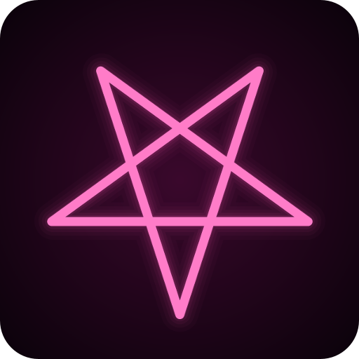
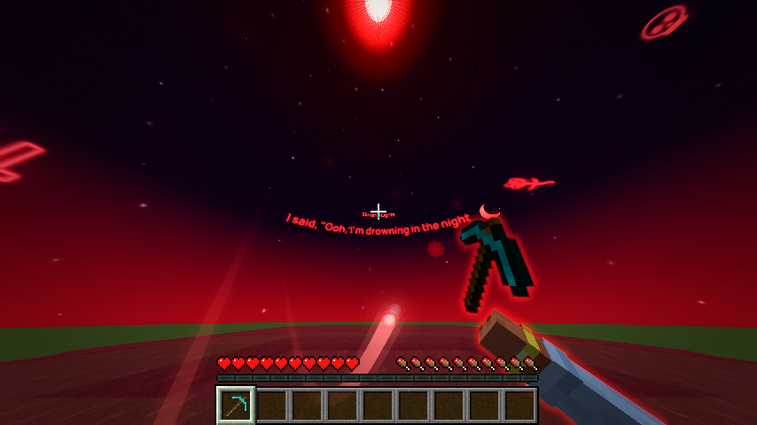
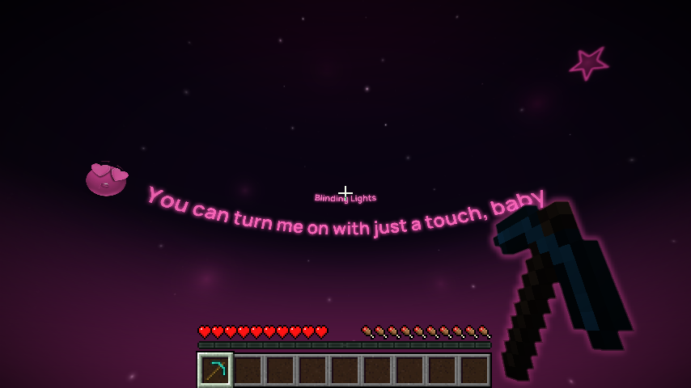
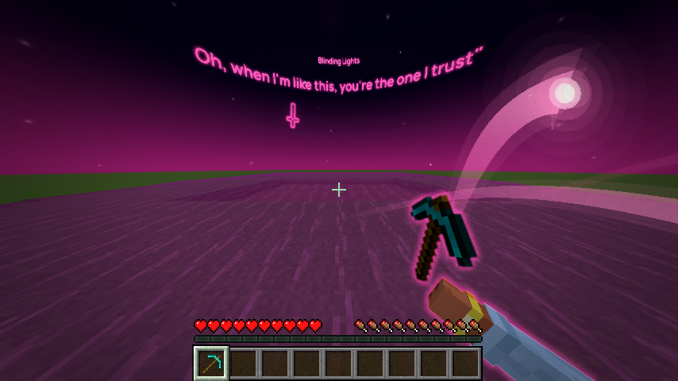
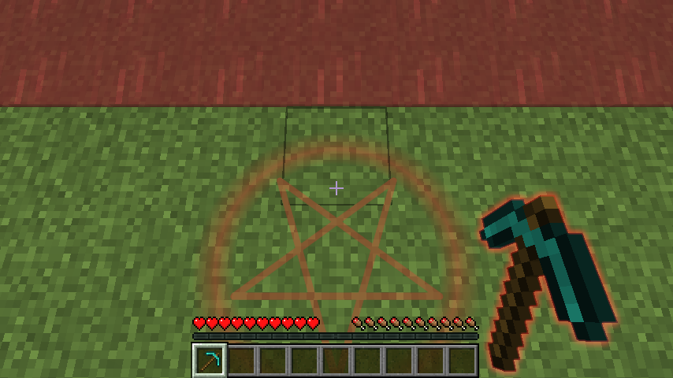
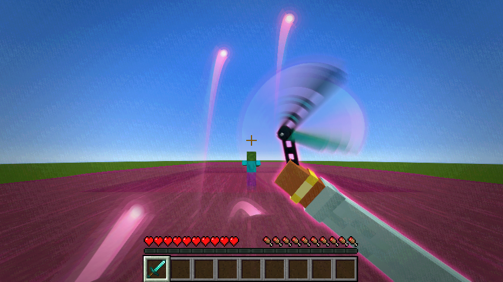
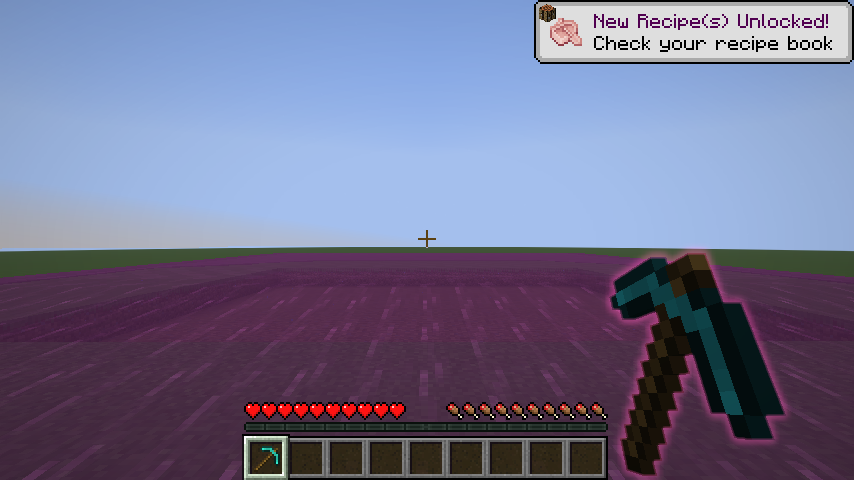
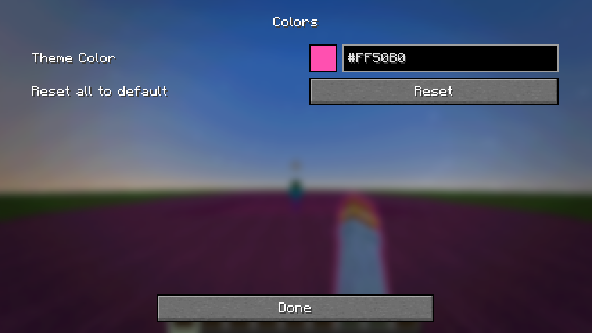

<div align="center">



# Atlas Visuals

**A glowing night sky that sings along to your Spotify, plus hand auras, coloured water and a gothic look.**
<br>Purely visual. No cheats, no ESP. Everything is only on your screen.


[**Download**](#download) · [Features](#features) · [Settings](#settings) · [Building](#building) · [Credits](#credits-and-license)



</div>

## Features

### Spotify Sky
Play a song in the Spotify desktop app and the sky lights up.

- **Synced lyrics in the sky.** The current line appears across the sky, in time with the song. This works for any song [LRCLIB](https://lrclib.net) has synced lyrics for.
- **The glow stays on through the whole session.** It doesn't drop out between tracks, and it keeps going on songs without lyrics.
- **Gothic sky symbols.** Pentagrams, inverted crosses, bats, skulls, spider webs, coffins, crescent moons and gravestones drift across the sky.
- **Emoji for the words being sung,** shown in your theme colour. Shooting stars, glitter and soft fog while the music plays.

### Hands and items
- **Hand Aura**: a soft glow around your hand and held item.
- **Hand Pose**: the held item sits farther away by default.
- **3D Hand**, **Swing Animation**, **Weapon Inspect** (press <kbd>F</kbd>), **Custom Glint**.

### World and particles
- **Water Color**, including the fog underwater.
- **Jump Circles**: a glowing pentagram where you land.
- **Atmosphere**, **Hit Particles**, **Floating Relics**, **Particles**, **Totem Spirit**.
- **Color Grading**, **Motion Blur**, **Custom FOV**, **Time Changer** (client-side only).
- **Light Overlay**: shows where mobs can spawn, like Lighty's carpet mode. Press <kbd>F8</kbd> to switch it on and off. Follows your theme colour, or use Lighty's red, orange and green, or pick your own.

## Screenshots

<table>
  <tr>
    <td></td>
    <td></td>
  </tr>
  <tr>
    <td align="center">Lyrics in the sky</td>
    <td align="center">Gothic sky symbols</td>
  </tr>
  <tr>
    <td></td>
    <td></td>
  </tr>
  <tr>
    <td align="center">Pentagram jump circle</td>
    <td align="center">Weapon inspect</td>
  </tr>
  <tr>
    <td></td>
    <td></td>
  </tr>
  <tr>
    <td align="center">Water colour and hand aura</td>
    <td align="center">One colour for everything</td>
  </tr>
</table>

## Download

| Minecraft | File | Java |
|---|---|---|
| 1.21.11 | [`atlas-visuals-1.0.0+1.21.11.jar`](releases/atlas-visuals-1.0.0+1.21.11.jar) | 21 |
| 26.3 | [`atlas-visuals-1.0.0+26.3.jar`](releases/atlas-visuals-1.0.0+26.3.jar) | 25 |

**Installation:** put the jar in your `mods` folder together with [Fabric API](https://modrinth.com/mod/fabric-api).
[Mod Menu](https://modrinth.com/mod/modmenu) is optional. The mod is tested with [Sodium](https://modrinth.com/mod/sodium) and also runs in Lunar Client's Fabric profiles.

The lyrics need the **Spotify desktop app** (tested on Windows).

## Settings

Open **Mod Menu → Atlas Visuals**, or type `/atlasvisuals` in a world.

- **Colors** sets one theme colour for everything: sky, fog, water, aura, particles, lyrics. You can type any hex code, for example `#FF50B0`.
- The menu is sorted into categories and has a **search box**. The search also finds settings inside the effects.
- Nothing is added to the title screen and there is no intro. The game starts as it would without the mod.

Settings are saved in `config/atlas-visuals.json`.

### Performance
Measured on an RTX 5070, everything switched on at the same time added about **0.7 ms per frame**. The default set added about 0.25 ms, and most single effects stay under 0.1 ms.

### Privacy
To find lyrics, the **song title and artist** are sent to [LRCLIB](https://lrclib.net). Nothing else is sent. Found lyrics are cached locally. You can turn this off with **Lyrics Online**, and the sky still glows without it.

## Building

The repository holds one Gradle project per Minecraft version:

```
atlas-visuals/          Minecraft 1.21.11  (JDK 21)
atlas-visuals-26.3/     Minecraft 26.3     (JDK 25)
releases/               ready-made jars
Modrinth/               store page text, icon and gallery
```

```
cd atlas-visuals-26.3
gradlew build
```

The jar is written to `build/libs/`. `gradlew runClientGameTest` starts a test world, goes through every effect and setting, and saves screenshots. Each project's README has the details.

## Credits and license

Licensed under **GPL-3.0-only**, see [`LICENSE`](LICENSE).

The visual effects are based on [Anubis](https://github.com/4ldenz/Anubis-client) by **4ldenz** (GPL-3.0). This is not an official Anubis build, and none of Anubis' combat, movement, macro, ESP or account features are included.
The Light Overlay follows the carpet mode of [Lighty](https://github.com/SchmarrnDevs/Lighty) by andi_makes and contributors (Apache-2.0).
Lyrics belong to their rights holders and are never bundled. Font: Manrope (SIL Open Font License).
